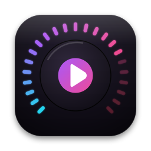
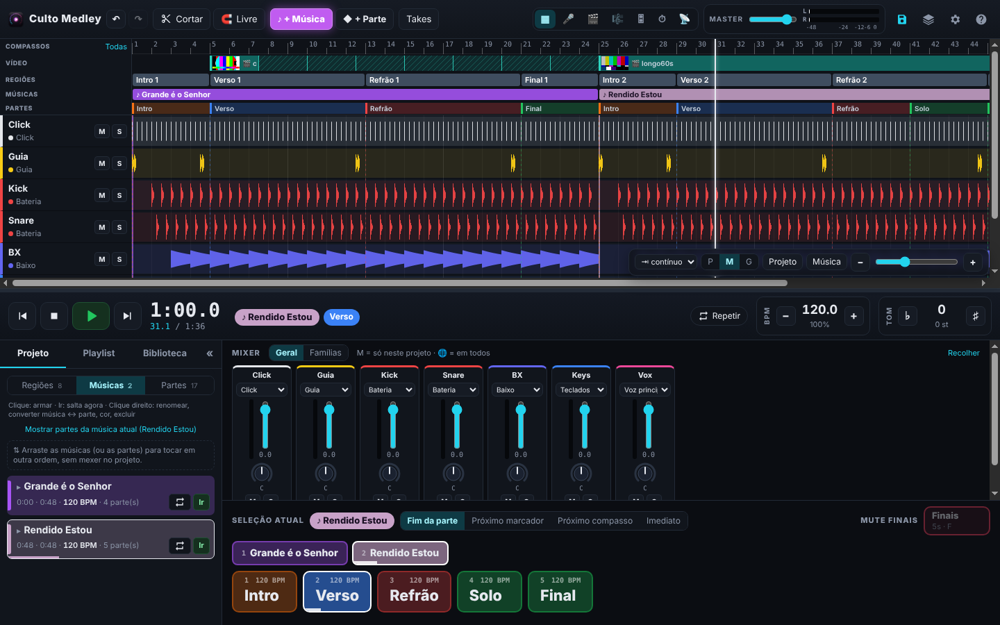

<h1 align="center">BM Beat</h1>

Player de VS / multitracks para palco — lê projetos do <b>REAPER (.RPP)</b>. macOS e Windows.

<a href="../../releases/latest"><b>⬇ Baixar a versão mais recente</b></a>

## Downloads

Na página [Releases](../../releases/latest):

| Sistema | Arquivo |
|---|---|
| macOS (Intel) | `BM-Beat-x.y.z-mac-x64.zip` |
| macOS (Apple Silicon M1/M2/M3/M4) | `BM-Beat-x.y.z-mac-arm64.zip` |
| Windows 10/11 (64 bits) | `BM-Beat-x.y.z-win-x64.zip` |

**macOS:** descompacte e arraste o **BM Beat** para Aplicativos. Na primeira vez, clique com o botão direito no app → **Abrir** → **Abrir** (o app ainda não é assinado pela Apple).
**Windows:** descompacte a pasta e abra **BM Beat.exe**. Se o SmartScreen avisar, clique em **Mais informações → Executar assim mesmo**.

## Recursos

- Abre projetos do REAPER: trilhas, marcas, regiões, tempo e cores.
- Marcas roxas = músicas; marcas coloridas = partes (verso, refrão, solo…). Armar parte/música e saltar no fim da parte, do marcador ou do compasso.
- Playlist com projetos expansíveis e **ordem personalizada** de músicas e partes, sem mexer no projeto.
- Famílias (bateria, baixo, guia, backs, teclados, sopro…) com mute global, saídas de áudio por família (mono/estéreo).
- Velocidade sem mudar o tom e mudança de tom sem afetar bateria, percussão, click e guia.
- Mixer, cortes e **mute finais**, cache de abertura rápida.
- Letras e vídeos para telões em outro monitor, partituras em PDF com página sincronizada, controle pela rede (celular/tablet), MIDI, timecode LTC/MTC.

## Apoie o projeto

Se o BM Beat ajuda no seu ministério ou nos seus shows, considere apoiar pelo botão **Sponsor ❤** no topo desta página.
